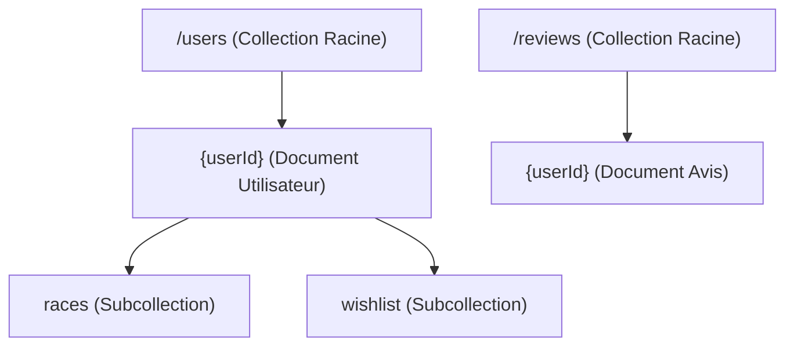

# Configuration Firebase Authentication & Firestore (RépertoireCourse)

Ce document décrit l'architecture de la base de données, la gestion des utilisateurs, les rôles ainsi que les règles de sécurité Firestore de l'application **RépertoireCourse**.

---

## 👥 Rôles et Gestion des Comptes

L'application gère trois rôles distincts d'utilisateurs. L'authentification s'appuie sur **Firebase Authentication** et la gestion des rôles est enregistrée dans le document de chaque utilisateur dans Firestore.

### 1. Comptes Utilisateurs Traditionnels (`role: 'user'`)
*   **Nombre** : Illimité.
*   **Création** : Créés automatiquement lors de l'inscription via le formulaire standard (`signup.html`).
*   **Droits** : Chaque utilisateur dispose d'un espace personnel et isolé. Il peut créer, lire, modifier et supprimer ses propres courses et sa propre wishlist. Il peut également gérer ses préférences (UI, confidentialité, thèmes) et laisser un avis dans la collection globale des avis.

### 2. Compte Administrateur (`role: 'admin'`)
*   **Nombre** : **Unique** (un seul compte existant).
*   **Droits** : 
    *   Accès complet et superviseur à l'application.
    *   Possibilité de lister tous les utilisateurs, de consulter leurs données (wishlist) et de visualiser les statistiques cumulées de tous les utilisateurs (via `js/admin-modal.js` et `js/admin-stats.js`).
    *   Accès en écriture globale pour la modération ou la maintenance.

### 3. Compte Invité (`role: 'invite'`)
*   **Nombre** : **Unique** (un seul compte existant).
*   **Droits** :
    *   Accès en **lecture seule** uniquement (aucune modification autorisée).
    *   Lors de la connexion, un modal de sélection s'affiche pour lui demander de choisir le carnet (l'adresse email) d'un utilisateur standard à consulter.
    *   Il peut ensuite naviguer et consulter l'intégralité des données du carnet choisi (courses, détails, statistiques complètes, prix, graphiques, wishlist, PDF, etc.).

---

## 🗄️ Structure de la Base de Données Firestore

Firestore est organisé avec une structure imbriquée (subcollections) afin de garantir la séparation et la sécurité des données de chaque utilisateur.



### 1. Collection racine `/users`
Contient les profils et les préférences de chaque utilisateur. Le `Document ID` correspond à l'UID Firebase de l'utilisateur.
*   **Champs principaux** : `email`, `role`, `pseudo`, `photoURL`, `createdAt`, `lastLogin`.
*   **Champs de configuration** : `privacy` (options d'affichage public), `uiPreferences` (préférences visuelles), `cardButtons` (boutons actifs sur les cartes), `cardTags` (tags visibles).

### 2. Subcollection `/users/{userId}/races`
Contient toutes les courses créées par l'utilisateur `{userId}`.

### 3. Subcollection `/users/{userId}/wishlist`
Contient la liste de souhaits (wishlist) de l'utilisateur `{userId}`.

### 4. Collection racine `/reviews`
Contient les avis laissés par les utilisateurs connectés. Le `Document ID` correspond à l'UID de l'auteur de l'avis.
*   **Champs principaux** : `stars`, `message`, `pseudo`, `photoURL`, `uid`, `updatedAt`, `approved` (brouillon ou publié).

---

## 📜 Règles de Sécurité Firestore (`firestore.rules`)

Voici les règles de sécurité à configurer dans votre console Firebase (**Firestore Database > Rules**) pour assurer le respect des permissions et la protection des données :

```javascript
rules_version = '2';
service cloud.firestore {
  match /databases/{database}/documents {
    
    // --- FONCTIONS UTILS ---
    
    function isAuthenticated() {
      return request.auth != null;
    }
    
    function getUserData() {
      return get(/databases/$(database)/documents/users/$(request.auth.uid)).data;
    }
    
    function isAdmin() {
      return isAuthenticated() && (
        (request.auth.token.admin == true) || 
        (getUserData().role == 'admin')
      );
    }
    
    function isInvite() {
      return isAuthenticated() && getUserData().role == 'invite';
    }
    
    function isOwner(userId) {
      return isAuthenticated() && request.auth.uid == userId;
    }

    // --- RÈGLES DES COLLECTIONS ---

    // 1. Profils Utilisateurs
    match /users/{userId} {
      // Les admins et invités peuvent lister les profils pour choisir un carnet dans le dashboard
      // Le propriétaire peut lire ses propres informations
      allow read: if isOwner(userId) || isAdmin() || isInvite();
      allow write: if isOwner(userId) || isAdmin();
      allow list: if isAdmin() || isInvite();

      // 2. Subcollection : Courses
      match /races/{raceId} {
        // Accès complet pour le propriétaire et l'admin
        // Lecture seule autorisée pour le compte invité
        allow read: if isOwner(userId) || isAdmin() || isInvite();
        allow write: if isOwner(userId) || isAdmin();
      }

      // 3. Subcollection : Wishlist
      match /wishlist/{wishId} {
        // Accès complet pour le propriétaire et l'admin
        // Lecture seule autorisée pour le compte invité
        allow read: if isOwner(userId) || isAdmin() || isInvite();
        allow write: if isOwner(userId) || isAdmin();
      }
    }

    // 4. Avis des Utilisateurs
    match /reviews/{userId} {
      // Tout le monde (y compris le public non connecté) peut lire les avis
      allow read, list: if true;
      // Seul l'auteur de l'avis ou l'admin peut écrire ou supprimer
      allow write: if isOwner(userId) || isAdmin();
    }
  }
}
```

---

## 🛠️ Dépannage et Maintenance

### Comment définir un rôle Admin ou Invité ?
1. Créez le compte normalement via le formulaire d'inscription (ou directement dans Firebase Authentication console).
2. Rendez-vous dans la base de données **Firestore**, localisez le document correspondant à l'UID du compte dans la collection `users`.
3. Modifiez le champ `role` : remplacez `'user'` par `'admin'` ou `'invite'`.
